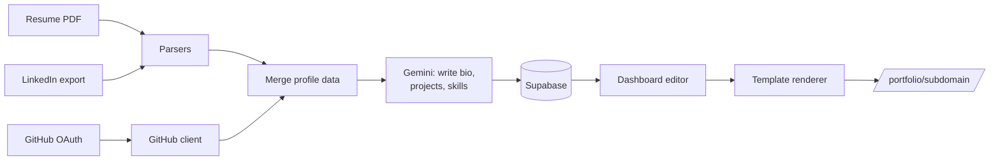

<div align="center">


# Resume-to-Portfolio

**Turn a resume, a GitHub profile and a LinkedIn export into a polished portfolio website, written by AI.**

[](https://github.com/pradeep23234545/portfolio-from-resume/actions/workflows/ci.yml)


[Features](#features) · [Tech stack](#tech-stack) · [Getting started](#getting-started) · [Project structure](#project-structure) · [Deployment](#deployment)

</div>

---

## Overview

Building a portfolio takes time most developers don't have. **Resume-to-Portfolio**
collects what you already have — your resume PDF, your GitHub repositories and your
LinkedIn data — and uses Google Gemini to write project descriptions, an "About me"
section and a skills summary. You pick a template, tweak the content in a dashboard,
and publish it at your own public URL.

<!-- Add a screenshot or GIF here once you have one:
 -->

## Features

- **Resume parsing** — upload a PDF and extract experience, education and skills.
- **GitHub import** — sign in with GitHub OAuth and pull in repositories, languages and stats.
- **LinkedIn import** — upload your LinkedIn data export to fill in work history.
- **AI writing** — Gemini generates project narratives, a professional bio and skill groupings, with automatic retry/fallback between models.
- **Six templates** — Modern Dev, Mono Focus, Artisan, Career Path, Grid Master and Digital CV.
- **Dashboard editor** — edit projects, experience and skills; customise colours and layout; live preview.
- **Public portfolio pages** — each user gets a page at `/portfolio/<subdomain>`.
- **Analytics** — view counts and engagement charts powered by Recharts.
- **Secure auth** — email/password (bcrypt + JWT in an HTTP-only cookie) and GitHub OAuth, with route protection in middleware.

## Tech stack

| Layer      | Tools |
| ---------- | ----- |
| Framework  | Next.js 16 (App Router, Server Actions, React Compiler), React 19, TypeScript |
| Styling    | Tailwind CSS, Radix UI primitives, shadcn/ui-style components, Framer Motion, Lucide icons |
| State/forms| Zustand, React Hook Form, Zod |
| Data       | Supabase (PostgreSQL, Storage, Row Level Security) |
| AI         | Google Gemini (`gemini-flash-latest`, `gemini-flash-lite-latest`, with automatic fallback) via `@google/generative-ai` |
| Integrations | GitHub REST & GraphQL (Octokit), PDF parsing (`pdf-parse`, `pdf2json`, `pdfjs-dist`) |
| Auth       | `bcryptjs`, `jose` (JWT) |

## Getting started

### Prerequisites

- **Node.js 20+** and npm
- A free [Supabase](https://supabase.com) project
- A [Google Gemini API key](https://aistudio.google.com/app/apikey)
- A [GitHub OAuth app](https://github.com/settings/developers) (for "Sign in with GitHub")

### 1. Clone and install

```bash
git clone https://github.com/pradeep23234545/portfolio-from-resume.git
cd portfolio-from-resume
npm install
```

### 2. Configure environment variables

```bash
cp .env.example .env.local
```

Then fill in `.env.local`:

| Variable | Required | Description |
| -------- | :------: | ----------- |
| `NEXT_PUBLIC_SUPABASE_URL` | ✅ | Your Supabase project URL |
| `NEXT_PUBLIC_SUPABASE_ANON_KEY` | ✅ | Supabase anon (public) key |
| `SUPABASE_SERVICE_ROLE_KEY` | ✅ | Supabase service-role key — **server only** |
| `JWT_SECRET` | ✅ | Long random string used to sign session tokens |
| `GEMINI_API_KEY` | ✅ | Google Gemini API key |
| `GITHUB_CLIENT_ID` | ✅ | GitHub OAuth app client ID |
| `GITHUB_CLIENT_SECRET` | ✅ | GitHub OAuth app client secret |
| `NEXT_PUBLIC_APP_URL` | ✅ | Base URL of the app, e.g. `http://localhost:3000` |
| `GITHUB_ACCESS_TOKEN` | — | Optional token for higher GitHub API rate limits |

When creating the GitHub OAuth app, set the callback URL to
`http://localhost:3000/api/auth/github/callback` (or your production URL).

### 3. Set up the database

For a new project, paste [`supabase/setup.sql`](supabase/setup.sql) into the Supabase
**SQL Editor** and click **Run**. It combines these files from
[`supabase/migrations`](supabase/migrations), which you can also run one by one in order:

1. `001_initial_schema.sql` — tables
2. `002_rls_policies.sql` — row-level security policies
3. `003_templates_data.sql` — default templates
4. `004_custom_auth.sql` — adapts `users` for the app's email/password login (required)

Then create a public Storage bucket named **`avatars`**.
See [docs/DATABASE_SETUP.md](docs/DATABASE_SETUP.md) for a single copy-paste script and troubleshooting.

### 4. Run it

```bash
npm run dev
```

Open [http://localhost:3000](http://localhost:3000).

### Available scripts

| Command | What it does |
| ------- | ------------ |
| `npm run dev` | Start the development server |
| `npm run build` | Create a production build |
| `npm start` | Serve the production build |
| `npm run lint` | Run ESLint |
| `npm run typecheck` | Run the TypeScript compiler without emitting files |
| `node scripts/list-models.js` | Check which Gemini models your API key can use |

## Project structure

```
src/
├── actions/              # Server Actions (dashboard, GitHub, resume, settings…)
├── app/
│   ├── (auth)/           # Login, signup, OAuth callback
│   ├── (dashboard)/      # Dashboard, editor, templates, analytics, settings
│   ├── api/              # Route handlers: auth, uploads, AI generation
│   ├── portfolio/[subdomain]/  # Public portfolio pages
│   └── page.tsx          # Landing page
├── components/
│   ├── dashboard/        # Sidebar, header, content editor, stats
│   ├── landing/          # Landing-page sections
│   ├── templates/        # Portfolio templates
│   └── ui/               # Reusable UI primitives
├── lib/
│   ├── ai/               # Gemini client with retry/fallback
│   ├── generators/       # Portfolio generation pipeline
│   ├── github/           # GitHub API client
│   ├── parsers/          # Resume (PDF) and LinkedIn parsers
│   ├── supabase/         # Browser, server and service-role clients
│   ├── store/            # Zustand stores
│   └── auth.ts           # Password hashing and JWT helpers
└── middleware.ts         # Protects dashboard routes
supabase/migrations/      # SQL schema, RLS policies, seed data
scripts/                  # Developer utilities
```

## How it works



## Deployment

The app runs on any Node.js host that supports Next.js — for example
[Vercel](https://vercel.com) or [Render](https://render.com).

1. Push the repository to GitHub.
2. Import it in your host and set the environment variables from the table above.
   Set `NEXT_PUBLIC_APP_URL` to your production URL.
3. Update your GitHub OAuth app's callback URL to
   `https://<your-domain>/api/auth/github/callback`.
4. Build command `npm run build`, start command `npm start`.

## Roadmap

- [ ] Custom domains per portfolio
- [ ] More templates and a theme builder
- [ ] Export portfolio as static HTML
- [ ] Automated tests

## Author

**Pradeep Yedage**
CSBS student at RAIT · aspiring software developer working with Python, Java and web development, exploring AI, automation and Web3.

[](https://github.com/pradeep23234545)

If this project helped you, consider giving it a ⭐ on GitHub.

## Contributing

Contributions are welcome — see [CONTRIBUTING.md](CONTRIBUTING.md).

## License

Released under the [MIT License](LICENSE) © 2026 Pradeep Yedage.
