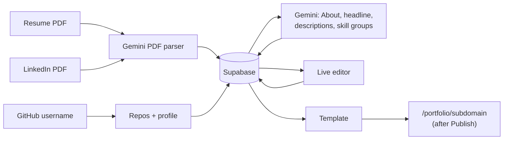

<div align="center">


# Resume-to-Portfolio

**Turn a resume, a GitHub profile and a LinkedIn export into a polished portfolio website, written by AI.**

**[Live app](https://pradeepyedage.vercel.app)** · **[Example portfolio](https://pradeepyedage.vercel.app/portfolio/pradeep23234545)**

[](https://github.com/pradeep23234545/portfolio-from-resume/actions/workflows/ci.yml)


[Features](#features) · [How to use](#how-to-use) · [Tech stack](#tech-stack) · [Getting started](#getting-started) · [Deployment](#deployment) · [Project structure](#project-structure)

</div>

---

## Overview

Building a portfolio takes time most developers don't have. **Resume-to-Portfolio**
collects what you already have — your resume PDF, your GitHub repositories and your
LinkedIn profile — and uses Google Gemini to write your "About me", headline, project
descriptions and skill groups. You review and edit everything with a live preview, pick
a template, and publish it at your own public URL.

<!-- Add a screenshot or GIF here once you have one:
 -->

## Features

- **Resume & LinkedIn import** — upload a resume PDF or your LinkedIn "Save to PDF" export; Gemini extracts experience, education, skills, projects and contact details. Duplicates across sources are skipped.
- **GitHub import** — link by username (or GitHub sign-in) to import your public repositories and your profile: name, photo, bio, location, website and X/Twitter.
- **AI writing** — one click writes your About section, headline, SEO text and missing project descriptions, and sorts skills into Frontend / Backend / Tools. It only uses facts from your data and never overwrites text you edited.
- **Live editor** — edit your photo, name, headline, About, contact links, projects (show/hide, reorder), experience, education and skills with an instant preview.
- **Three templates** — Modern, Minimal and Creative, each in five colour themes and three font styles, with profile photo, education and working contact links (email opens Gmail).
- **Draft & publish** — portfolios stay private drafts until you click **Publish Live**; unpublish any time.
- **Analytics** — privacy-friendly visit tracking (no IP addresses stored): views, unique visitors, devices, countries and referrers.
- **Secure auth** — email/password (bcrypt + JWT in an HTTP-only cookie) and optional GitHub OAuth.

## How to use

1. **Sign up** at `/signup`.
2. **Connect** your data: enter your GitHub username and upload your resume and/or LinkedIn PDF.
3. **Generate**: the AI builds a draft portfolio (about 10–30 seconds).
4. **Customize**: review and edit everything with the live preview, pick a template and colours, then **Save**.
5. **Preview → Publish Live**, and share `https://<your-domain>/portfolio/<your-subdomain>`.

## Tech stack

| Layer      | Tools |
| ---------- | ----- |
| Framework  | Next.js 16 (App Router, Server Actions, React Compiler), React 19, TypeScript |
| Styling    | Tailwind CSS, Radix UI primitives, shadcn/ui-style components, Framer Motion, Lucide icons |
| State/forms| Zustand, React Hook Form, Zod |
| Data       | Supabase (PostgreSQL, Storage, Row Level Security) |
| AI         | Google Gemini (`gemini-flash-latest`, `gemini-flash-lite-latest`, with automatic fallback) via `@google/generative-ai` |
| Integrations | GitHub REST API, PDF text extraction (`pdf2json`) |
| Auth       | `bcryptjs`, `jose` (JWT) |

## Getting started

### Prerequisites

- **Node.js 20+** and npm
- A free [Supabase](https://supabase.com) project
- A [Google Gemini API key](https://aistudio.google.com/app/apikey)
- *Optional:* a [GitHub OAuth app](https://github.com/settings/developers), only for "Sign in with GitHub" (linking GitHub by username works without it)

### 1. Clone and install

```bash
git clone https://github.com/pradeep23234545/portfolio-from-resume.git
cd portfolio-from-resume
npm install
```

### 2. Configure environment variables

```bash
cp .env.example .env.local
```

Then fill in `.env.local`:

| Variable | Required | Description |
| -------- | :------: | ----------- |
| `NEXT_PUBLIC_SUPABASE_URL` | ✅ | Your Supabase project URL |
| `NEXT_PUBLIC_SUPABASE_ANON_KEY` | ✅ | Supabase anon (public) key |
| `SUPABASE_SERVICE_ROLE_KEY` | ✅ | Supabase service-role key — **server only** |
| `JWT_SECRET` | ✅ | Long random string used to sign session tokens |
| `GEMINI_API_KEY` | ✅ | Google Gemini API key |
| `NEXT_PUBLIC_APP_URL` | ✅ | Base URL of the app, e.g. `http://localhost:3000` or your production URL |
| `GITHUB_CLIENT_ID` | — | GitHub OAuth app client ID (only for "Sign in with GitHub") |
| `GITHUB_CLIENT_SECRET` | — | GitHub OAuth app client secret |
| `GITHUB_ACCESS_TOKEN` | — | Token for higher GitHub API rate limits |
| `GEMINI_MODEL` / `GEMINI_FAST_MODEL` | — | Override the default Gemini models |

`JWT_SECRET` must be at least 16 characters in production — the app refuses to sign
logins without it. Generate one with:

```bash
node -e "console.log(require('crypto').randomBytes(32).toString('hex'))"
```

If you use GitHub OAuth, set the app's callback URL to
`<NEXT_PUBLIC_APP_URL>/api/auth/github/callback`.

### 3. Set up the database

For a new project, paste [`supabase/setup.sql`](supabase/setup.sql) into the Supabase
**SQL Editor** and click **Run**. It combines these files from
[`supabase/migrations`](supabase/migrations), which you can also run one by one in order:

1. `001_initial_schema.sql` — tables
2. `002_rls_policies.sql` — row-level security policies
3. `003_templates_data.sql` — default templates
4. `004_custom_auth.sql` — adapts `users` for the app's email/password login (required)

The `avatars` storage bucket for profile photos is created automatically on the first upload.
See [docs/DATABASE_SETUP.md](docs/DATABASE_SETUP.md) for details and troubleshooting.

### 4. Run it

```bash
npm run dev
```

Open [http://localhost:3000](http://localhost:3000).

### Available scripts

| Command | What it does |
| ------- | ------------ |
| `npm run dev` | Start the development server |
| `npm run build` | Create a production build |
| `npm start` | Serve the production build |
| `npm run lint` | Run ESLint |
| `npm run typecheck` | Run the TypeScript compiler without emitting files |
| `node scripts/list-models.js` | Check your Gemini key: list available models and test the ones the app uses |

## Project structure

```
src/
├── actions/              # Server Actions: generate, editor save, publish, GitHub, resume…
├── app/
│   ├── (auth)/           # Login, signup, OAuth callback
│   ├── (dashboard)/      # Dashboard, editor, templates, analytics, settings
│   ├── api/              # Route handlers: auth, uploads, generation, analytics, health
│   ├── portfolio/[subdomain]/  # Public portfolio pages
│   └── page.tsx          # Landing page
├── components/
│   ├── dashboard/        # Sidebar, header, content editor, stats
│   ├── landing/          # Landing-page sections
│   ├── templates/        # Portfolio templates
│   └── ui/               # Reusable UI primitives
├── lib/
│   ├── ai/               # Gemini client with retry/fallback
│   ├── generators/       # AI portfolio generation
│   ├── github/           # GitHub profile import
│   ├── parsers/          # Resume / LinkedIn PDF parser (Gemini)
│   ├── portfolio/        # Loads a portfolio for templates and the editor
│   ├── supabase/         # Browser, server and service-role clients
│   ├── store/            # Zustand stores
│   └── auth.ts           # Password hashing and JWT helpers
└── middleware.ts         # Protects dashboard routes
supabase/setup.sql        # One-shot database setup (all migrations combined)
supabase/migrations/      # SQL schema, RLS policies, seed data
vercel.json               # Daily health check that keeps the free database awake
scripts/                  # Developer utilities
```

## How it works



## Deployment

The recommended host is [Vercel](https://vercel.com) (free Hobby plan); Supabase and
Gemini are already hosted services.

1. Push the repository to GitHub.
2. In Vercel: **Add New → Project**, import the repo (the Next.js preset is detected).
3. Under **Environment Variables**, paste the contents of your `.env.local` (at least the
   five required variables). Do **not** add Vercel's Supabase integration — it would create a
   new, empty database.
4. **Deploy.** Under **Settings → Domains** you can add a free `your-name.vercel.app` address.
5. Set `NEXT_PUBLIC_APP_URL` to that address and redeploy.
6. Sign in on the live site, open **Preview** and click **Publish Live**.

Every `git push` to `main` redeploys automatically. `vercel.json` schedules a daily call to
`/api/health` so the free Supabase project is not paused for inactivity. Share only your
production domain — the long per-deployment URLs require a Vercel login.

## Roadmap

- [ ] More templates (Career Path, Grid, Digital CV)
- [ ] Project screenshots and image uploads
- [ ] Export portfolio as static HTML / PDF
- [ ] Custom domains per portfolio
- [ ] Automated tests

## Author

**Pradeep Yedage**
CSBS student at RAIT · aspiring software developer working with Python, Java and web development, exploring AI, automation and Web3.

[](https://github.com/pradeep23234545)

If this project helped you, consider giving it a ⭐ on GitHub.

## Contributing

Contributions are welcome — see [CONTRIBUTING.md](CONTRIBUTING.md).

## License

Released under the [MIT License](LICENSE) © 2026 Pradeep Yedage.
